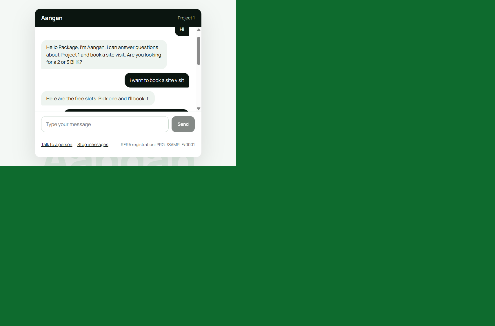
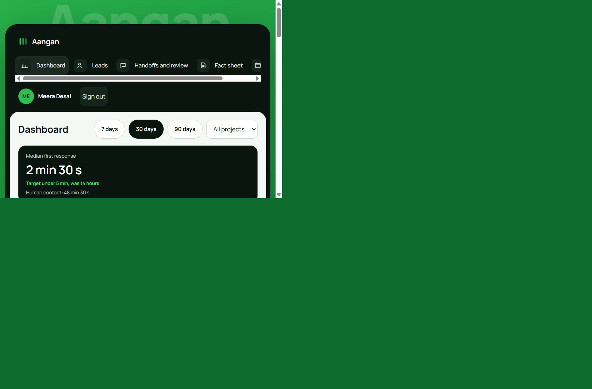
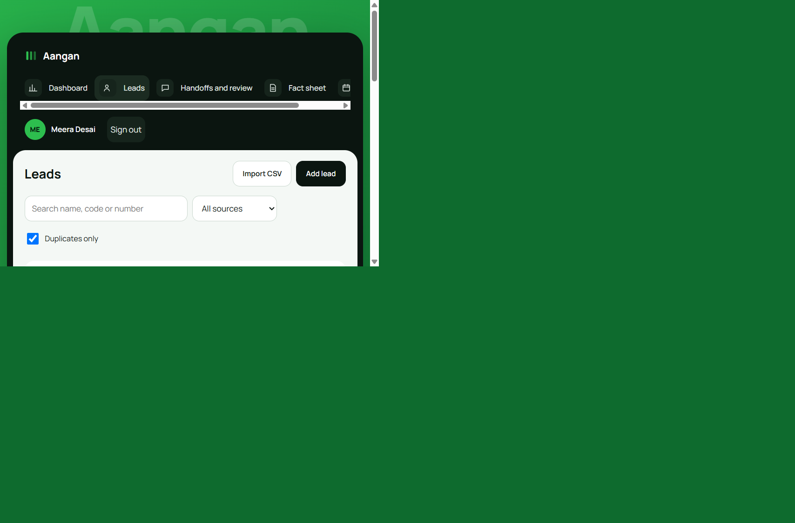
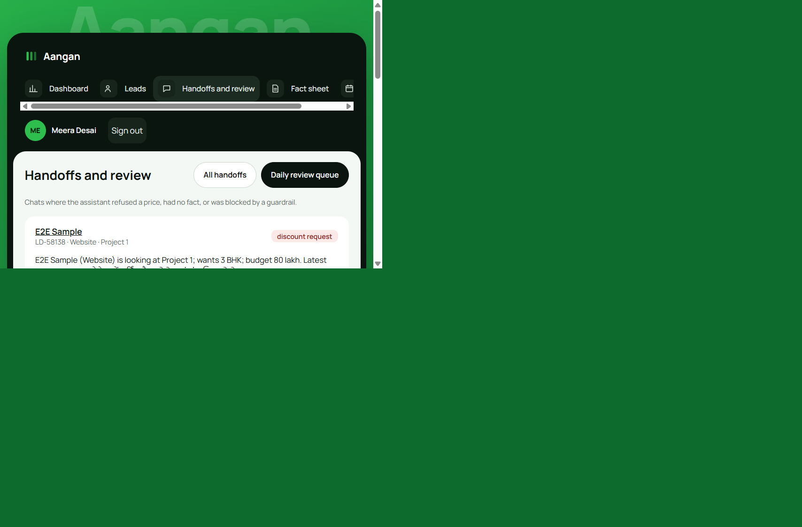
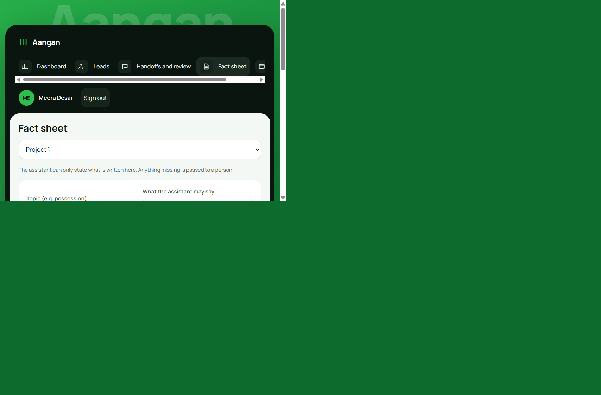

# Technical Design Document: Aangan, AI lead-response and site-visit booking assistant

**GitHub:** `<add GitHub URL>` · **Live app:** `<add live URL>`

TODO before submission: replace the GitHub and live app URL placeholders.

Client context: residential real-estate developer in Ahmedabad. The demo seeds two generic sample projects; the
provided brief does not specify an apartment count, response-time SLA, project facts, or pricing. The assistant aims
to respond in the buyer's language, book a genuinely available site visit, and hand serious buyers to a named executive.

## 1. Architecture and why

| Layer | Choice | Why |
|---|---|---|
| Backend | Django 5 + Django REST Framework | Fast to build safely: ORM, auth, validation, migrations, admin. Business rules live in `core/services/`, not in views |
| Database | SQLite locally, Postgres in production (`DATABASE_URL`) | Same code on both. The no-double-booking rule uses partial unique constraints, which both support |
| Frontend | React + Vite, plain CSS | Small bundle (about 68 kB gzip), no UI kit, so the design stays minimal and consistent |
| AI | Anthropic tool use, with an offline rule agent as fallback | Tools make the assistant act on real data. The fallback means the demo runs without a key and the buyer always gets an answer if the API fails |
| Auth | DRF token auth for staff; buyers chat with a per-chat secret token | Buyers need no account. Staff get roles (sales head, executive) |

```
Buyer chat (React) -> /api/chat/* -> agent.respond()
                                      |- intents (person, opt-out, discount) handled by server rules
                                      |- brain: Claude tool-use loop OR rule agent
                                      |    tools: search_fact_sheet, get_free_slots, book_visit,
                                      |           save_lead_profile, handoff_to_human
                                      '- output guardrail on every reply
Staff (React) -> /api/leads, /handoffs, /dashboard, /facts, /slots (role-checked)
```

### HTTP API

All endpoints are under `/api/`; staff routes require token authentication. Public routes are projects and consented buyer chat.

| Area | Endpoints |
|---|---|
| Auth/projects | `POST /auth/login`, `GET /auth/me`, `GET /public/projects` |
| Buyer chat | `POST /chat/start`, `POST /chat/{lead_id}/message`, `POST /chat/{lead_id}/opt-out` |
| Leads/visits | `GET/POST /leads`, `POST /leads/import`, `GET /leads/{id}`, `POST /visits/{id}/status` |
| Handoffs | `GET /handoffs`, `GET /handoffs?review=1`, `POST /handoffs/{id}/ack`, `POST /handoffs/{id}/review` |
| Dashboard | `GET /dashboard?from=YYYY-MM-DD&to=YYYY-MM-DD&project={id}` |
| Editors | `GET/POST /facts`, `DELETE /facts/{id}`, `GET/POST /slots`, `PATCH/DELETE /slots/{id}`, `GET /executives` |
| Reminders | `GET /reminders`, `POST /reminders/run` |

## 2. Data model

`Project` (RERA no, location pin) · `FactSheetEntry` (project, key, value) · `Lead` (source, normalised phone, consent,
opt_out, duplicate_of, first_response_at, human_contact_at, assigned_to) · `ChatMessage` (flagged, flag_reason) ·
`VisitSlot` (project, executive, start) · `Visit` (lead, slot, status) · `Reminder` (visit, kind, send_at, status, body) ·
`Handoff` (lead, executive, reason, summary, flagged, reviewed_at) · `SourceSpend` (source, month, amount) · `Profile` (role).

## 3. Main flows

**Buyer chat.** Consent box and mobile number required, then chat. A returning number continues its old chat.
The first assistant reply sets `first_response_at`, which feeds the dashboard's response time.

**Booking without double booking (the hard part).** The model never writes to the database. `book_visit()` re-checks
everything on the server (slot exists, same project, not in the past, not taken, buyer has no open visit) and the
database has the final say through two partial unique constraints: one booked visit per slot, one booked visit per lead.
If two buyers race, one gets an `IntegrityError`, which becomes "slot taken" and the assistant offers other slots.
The agent may only book a `slot_id` it was shown by `get_free_slots` in the same turn.
Test: 20 threads book the same slot, exactly 1 wins (`test_booking.py`).

**Reminders.** Booking schedules 1-day and 2-hour reminders (only those still in the future). The dispatcher skips
opted-out buyers, buyers without consent, and cancelled visits. Every message carries the RERA number and the location
pin. Sending is mocked: the text is stored and logged.

**Handoff.** Triggers: buyer asks for a person, fact missing, price or discount asked, guardrail blocked a reply.
One open handoff per lead, assigned to the lead's executive or the least-loaded one, with a summary of needs, budget,
visit and last messages. Flagged handoffs appear in the sales head's daily review queue.

**Duplicates.** Phone numbers are normalised to 10 digits. A second enquiry from the same number (other source, CSV
import, manual add) is stored as a duplicate of the first, so source attribution is kept but counts are not inflated.

**Staff editors.** Fact-sheet entries are created or updated by key and can be deleted. Future visit slots can be
created, edited (project, executive, date and hour), or removed; booked slots cannot be edited or deleted.

## 4. How the AI part works, and what happens when it is wrong

| Risk | Control |
|---|---|
| Invents a fact | System prompt says facts only from `search_fact_sheet`. If nothing is found: "a team member will confirm" and handoff, flagged for review |
| Quotes a price or discount | Prompt forbids it, and a server filter checks every reply. Discount words (English, Hindi, Gujarati) are always blocked. A money amount is allowed only if it appears word for word in the fact sheet. Blocked replies are replaced by a handoff message and flagged |
| Books a wrong or made-up slot | Server-validated tool, see section 3 |
| Buyer wants a human | Detected by server rules before the model runs |
| Buyer says stop | Opt-out flag set, reminders skipped, never contacted again |
| API down or slow | Falls back to the rule agent, so the buyer always gets an answer |
| Language | Replies follow the buyer's script (English, Hindi, Gujarati) |

## 5. UI and design decisions

- Staff app uses a dark sidebar, light content panel, one green accent, and a large faint "Aangan" wordmark behind
  the frame (never behind data).
- Dashboard: three headline numbers tied to the client's targets, one bar chart (visits per day), one source table with
  best and review tags, cost per visit as the big number. Cost per visit shows "–" when there are no visits.
- Buyer chat: calm, one column, large touch targets, slot picker as buttons, confirmation card with location pin,
  RERA number and opt-out always visible.
- Every list has loading, empty and error states. Tables become cards on phones.

### Screenshots

These are browser captures of seeded, fictional demo records; no real buyer data is shown.

#### Buyer booking confirmation



The confirmation keeps the selected time, named executive, address, map link, and RERA identifier together.

#### Dashboard



The light metrics panel and source table keep operational measures visible without placing the wordmark behind data.

#### Lead list with duplicate



The source tag and duplicate relationship remain visible in the unified lead list.

#### Handoff review



The queue surfaces the executive, reason, and concise conversation summary for review.

#### Fact sheet editor



Sales staff can maintain the bounded fact source that the assistant is allowed to use.

## 6. Security and privacy

No secrets in the repo (`.env.example` lists names only). Inputs validated with DRF serializers; phone, date, hour and
file-size checks. Role checks on every staff endpoint (executives see only their leads). Rate limits on chat and login.
Consent and opt-out stored per lead (DPDP). CORS limited to the frontend origin.

## 7. Tests (44)

Concurrent booking, booking rules, reminder timing and opt-out, guardrail filter, agent behaviour (fact answers,
handoff on missing fact, discount refusal, person request, opt-out, hallucinated slot id), phone normalisation and
duplicates, dashboard maths on a small fixed dataset (median, show-up, not-reached, cost per visit with zero visits),
access control, short and localized BHK/budget replies, visit-slot quick replies, repeated-question limits, and blocking
chat replies after opt-out, final-price request routing, cancelled-visit reminder suppression, slot update protection,
and project-filtered dashboard metrics.

## 8. What I cut and what I would do next

Cut: WhatsApp (web chat only), real SMS, login for buyers, slot capacity above 1, editing or rescheduling a visit by chat,
projects/executives editor (done in Django admin), in-app PDF export. This submission document is generated separately.
Next: WhatsApp Business with approved templates, a scheduled worker for reminders, reschedule by chat, a retrieval step
for large fact sheets, a no-show follow-up, translation review of the Hindi and Gujarati templates by a native speaker.

## 9. Limits I want to be honest about

- The Claude tool-use path was written to the API but not run against a live key in my build environment. The rule agent
  and all guardrails are tested. Run once with a key before relying on it.
- The rule agent matches keywords. It hands off when unsure, but it can pick a loosely related fact.
- Hindi and Gujarati templates were written by me and should be checked by a native speaker.
- The dashboard computes in Python over the filtered leads. Fine at this scale; move to SQL aggregates at tens of thousands of leads.

## 10. Assumptions (labelled)

1. Slots are 1 hour with capacity 1; one executive works one project.
2. Cost per lead is about ₹1,000. Seeded monthly spend per source equals seeded leads × ₹1,000 (the brief gives no spend per source).
3. All seeded project facts (configurations, price range, possession dates, amenities, parking, address) are invented sample data. The price range is indicative only, not a final quote.
4. RERA numbers in seed data are placeholders (`PRGJ/SAMPLE/000x`).
5. Reminders and messages are mocked. WhatsApp is out of scope beyond opt-in and template design.
6. "Not reached in 48 h" counts leads older than 48 h with no assistant reply inside 48 h. The AI reply counts as a response.
7. Show-up rate = visited / (visited + no-show); future bookings are excluded.
8. The sample leads from the brief are seeded as given. LD-58210's visit (1 Nov) is left as "booked" because the brief does.
9. Executives see only leads assigned to them; the sales head sees everything.
